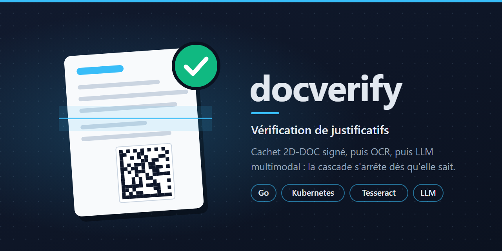
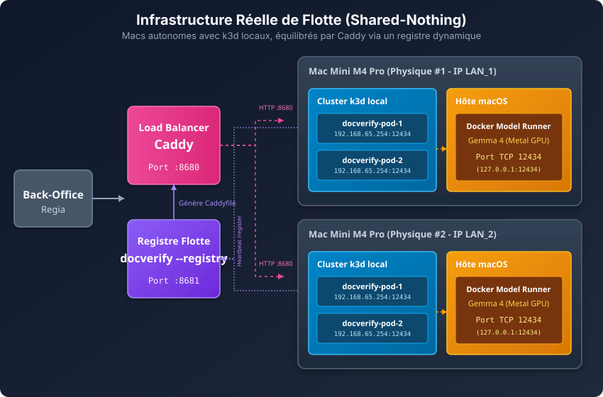

# docverify


> **Projet de stage, publié anonymisé.** Les noms d'entreprise, de produits,
> de clients et de personnes ont été remplacés, et les documents d'exemple
> retirés. Voir [ANONYMISATION.md](ANONYMISATION.md).

`docverify` est un service Go qui vérifie des justificatifs administratifs : factures, cartes d'identité, passeports, justificatifs de domicile. Le back-office Regia lui envoie un document avec l'identité et l'adresse attendues, et docverify répond par un verdict : le document est-il valide, le nom et le code postal correspondent-ils, la date est-elle encore bonne. Pour y arriver il combine de l'OCR classique et un LLM multimodal, le tout sur Kubernetes.

La doc détaillée est dans le [wiki](https://git.int.orbinea.example/tfuchs/docverify/wiki/Home). Ce README donne la vue d'ensemble et ce qu'il faut pour développer en local.

## Comment ça marche

Regia POSTe le document sur l'API. Le serveur le place dans une queue Go interne au pod, un worker le traite, le fichier temporaire est supprimé et le verdict renvoyé. Cette queue sert à borner le nombre d'appels LLM simultanés, sans avoir besoin d'un Redis.

Le traitement est une cascade qui s'arrête dès qu'elle a de quoi décider :

1. Si le document porte un cachet 2D-DOC, le Datamatrix signé des justificatifs français, tout le reste est court-circuité. L'identité, l'adresse et la date sortent directement des données signées, sans OCR ni LLM, et la signature est vérifiée contre les certificats ANTS embarqués dans le binaire.
2. Sinon on extrait le texte : `pdftotext` pour un PDF natif, Tesseract pour une image à fond simple.
3. Si l'extraction est trop pauvre ou le fond trop complexe, comme les fonds guillochés des pièces d'identité, docverify bascule sur le LLM multimodal.
4. En dernier recours, la page est découpée en zones traitées séparément. C'est utile quand un scan contient le recto et le verso d'une CNI sur la même image.

À chaque étape, un résultat n'est retenu que s'il extrait plus d'informations que le précédent.

Le verdict porte un niveau de confiance à quatre paliers, de `nul` à `haut`, qui dépend du chemin emprunté : un 2D-DOC vérifié ou un OCR net donnent `haut`, le LLM plafonne à `moyen`, la segmentation reste à `bas` et un document illisible vaut `nul`. Regia s'en sert pour automatiser : traitement automatique sur `haut`, confirmation manuelle sur `moyen` et `bas`, rejet sur `nul`.

Le LLM est servi par Docker Model Runner : le modèle vision `Gemma 4 E4B` au format GGUF tourne sur le GPU Metal, en process hôte. Les pods l'atteignent par la passerelle hôte fixe `192.168.65.254:12434` plutôt que par un nom DNS, parce que le DNS interne de k3d ne survit pas toujours à un redémarrage. Côté code, docverify ne connaît qu'une URL OpenAI-compatible et un nom de modèle : on peut remplacer le backend LLM sans toucher au service.

## Architecture

### Développement local, k3d mono-nœud

Les pods `docverify` tournent dans un cluster `k3d` local et atteignent le **Docker Model Runner** de l'hôte pour profiter du GPU Metal :


Chemin d'une requête : **Regia** &rarr; **pod docverify** &rarr; **Docker Model Runner hôte** &rarr; **Gemma 4 E4B**.

### Production, cluster multi-nœuds shared-nothing

Le cluster regroupe plusieurs Mac Mini autonomes, Mac principal compris puisqu'il sert aussi de worker. Chaque Mac fait tourner son propre cluster `k3d` et son propre DMR. L'image docverify est construite une fois, poussée sur le registre interne `alpha.srv.orbinea:5000`, et chaque k3d la tire de là. Un Load Balancer **Caddy** statique répartit les requêtes, à raison d'une ligne `to <IP>:8680` par Mac. Quand un nœud tombe, le health-check `/health` le sort tout seul de la rotation :



## Briques externes

| Projet | Rôle |
|---|---|
| [Docker Model Runner](https://docs.docker.com/ai/model-runner/) | Sert un GGUF en endpoint OpenAI-compatible sur GPU Metal, en process hôte |
| [Gemma 4 E4B](https://huggingface.co/unsloth/gemma-4-e4b-it-gguf) | Modèle vision-langage par défaut, `huggingface.co/unsloth/gemma-4-e4b-it-gguf:Q5_K_M` |
| [k3d](https://k3d.io) | k3s dans des conteneurs Docker, pour le cluster local |

## Développer et tester en local

Le projet est du Go pur, sans aucune dépendance Go externe. Il faut par contre quelques outils système et un endpoint LLM joignable.

```bash
brew install go tesseract tesseract-lang poppler imagemagick dmtx-utils jq
go build -o docverify ./cmd/docverify
```

Le binaire a trois modes. Lancé sans argument, il démarre le serveur HTTP sur `:8680` et l'URL du LLM se règle avec `LLM_URL`. Lancé avec un fichier ou du JSON, il analyse un document unique. Et si l'entrée JSON contient une liste `individuals`, il passe en mode batch.

```bash
LLM_URL=http://localhost:12434/engines ./docverify     # serveur HTTP
./docverify input.json                        # un seul document
./scripts/test-api.sh all                    # suite de tests sur les samples
```

La route, les champs et le mode webhook sont décrits sur la page wiki [API HTTP](https://git.int.orbinea.example/tfuchs/docverify/wiki/API-HTTP).

## Déployer

Le backend LLM est Docker Model Runner, à activer dans Docker Desktop avec le TCP host-side. On tire le modèle une fois par Mac, puis il y a deux chemins selon la cible :

```bash
docker model pull huggingface.co/unsloth/gemma-4-e4b-it-gguf:Q5_K_M   # backend LLM, une fois par Mac

./scripts/redeploy.sh         # DEV LOCAL : build + import k3d + override local, sans registre
./scripts/deploy-cluster.sh   # CLUSTER : build + push registre, puis rollout de chaque nœud
```

Le manifeste `deploy/k8s/docverify-deployment.yaml` cible l'image du registre interne avec `imagePullPolicy: Always`. Un Mac neuf s'intègre au cluster depuis le Mac de contrôle avec `deploy/cluster/bootstrap-node.sh <ip>` : le script pousse la config, installe les outils, provisionne le k3d et affiche la ligne à coller dans le `Caddyfile`. Pour servir le LLM depuis une machine Linux à GPU, `deploy/llm/` fournit des images vLLM par accélérateur, voir `deploy/llm/README.md`.

## Documentation

| Page | Contenu |
|---|---|
| [API HTTP](https://git.int.orbinea.example/tfuchs/docverify/wiki/API-HTTP) | Route, champs multipart, réponses, webhook, codes d'erreur |
| [Scripts](https://git.int.orbinea.example/tfuchs/docverify/wiki/Scripts) | Outillage et configuration par `.env` |
| [Commandes utiles](https://git.int.orbinea.example/tfuchs/docverify/wiki/Commandes-utiles) | Logs, shell dans un pod, scale, backend LLM |
| [Dashboard](https://git.int.orbinea.example/tfuchs/docverify/wiki/Dashboard) | Dashboard Kubernetes, installation et accès |

## Scripts

Le dossier `scripts/` regroupe l'outillage de dev et d'exploitation. Les paramètres communs vivent dans un `.env` à la racine : copier `.env.example` en `.env` et ajuster.

| Script | Rôle |
|---|---|
| `test-api.sh` | Tests HTTP contre les samples, un cas ou tous |
| `concurrency-test.sh` | Rafale parallèle, garde anti-contamination |
| `bench-models.sh` + `score-bench.sh` | Bench multi-modèles et scoring |
| `redeploy.sh` | Dev local : build + import k3d + override local, sans registre |
| `deploy-cluster.sh` | Cluster : build + push registre, rollout de chaque nœud via SSH |
| `monitor-cluster.sh` | Dashboard temps réel du cluster, à partir du `/health` enrichi |
| `bootstrap-node.sh` | Intègre un Mac neuf depuis le contrôle : config, outils, k3d |
| `provision-node-registry.sh` | Cœur registre : recrée le k3d d'un Mac pour tirer du registre |
| `fetch-2ddoc-leaves.sh` | Rafraîchit les certificats feuilles 2D-DOC embarqués dans le binaire |
| `push-wiki.sh` | Pousse `wiki/` vers le wiki Gitea |

## Machines

Le cluster, c'est quatre Mac Mini M4 Pro 12 cœurs en shared-nothing, chacun avec son nœud k3d et son DMR local. Le principal a 48 Go et cumule poste de dev, front Load Balancer et worker. Les trois autres ont 24 Go.

Pour tenir dans 24 Go, le modèle de production est quantisé en `Q5_K_M`, soit 5,09 GiB. On l'a préféré au `Q8` pour économiser 3 Go de VRAM par nœud, tout en gardant 100 % de justesse au benchmark. Côté charge, le cycle de vie des jobs est découplé, avec un timeout d'attente court en file et un timeout d'exécution garanti une fois le job pris par un worker : c'est ce qui permet d'encaisser les rafales sans crash ni timeout.
